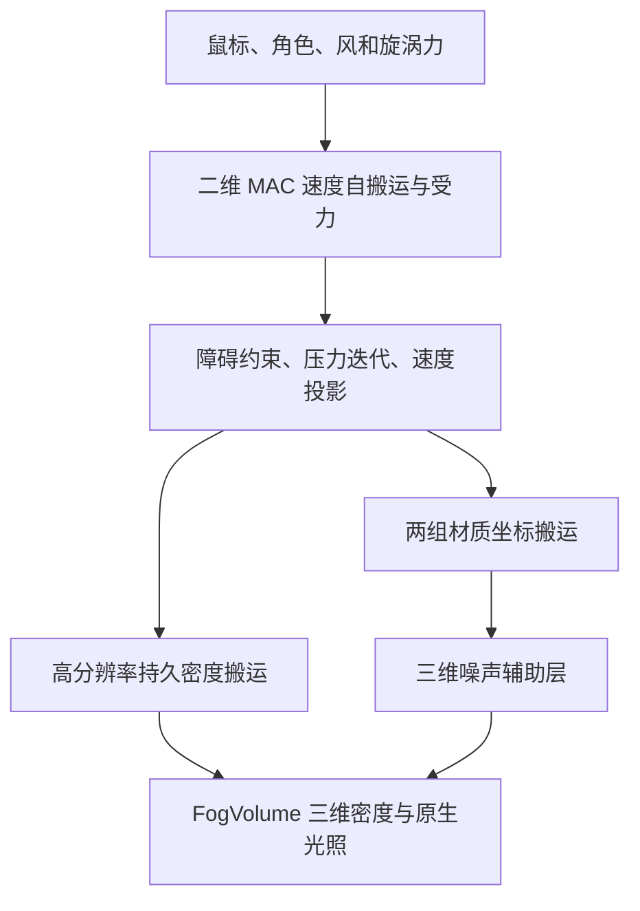

# Interactive Fog / 可交互贴地雾

Godot 4.7 / Forward+ 的浅层交互雾。二维流体负责水平运动，主要可见细节存在持久密度中；三维噪声补充纵向层次，并通过随流搬运的材质坐标采样。

鼠标和角色向同一速度场施力。密度与纹理一起被推移、拉长和卷起，停止输入后继续演化。场内不再自动恢复固定图案，也不直接擦出空洞或填入预设浓雾环。

## 运行

打开 `project.godot`，等待 Compute Shader 导入，F5 运行。使用 Forward+，默认 Windows / D3D12；Mobile 和 Compatibility 不支持此处的 FogVolume。

| 输入 | 行为 |
| --- | --- |
| WASD / 方向键、Shift | 角色移动、加速，推动雾并留下尾流 |
| 左键拖动 | 根据笔刷的实际世界速度向流场施力 |
| 左键单击 | 注入小旋涡；按住静止时不持续擦除雾 |
| Space | 短时偏心卷流，形状由流体演化 |
| 右键拖动、滚轮 | 环绕相机、缩放 |
| R / P / Tab | 重置 / 暂停 / 二维场图 |

左侧可调光学密度、**上风边界补雾半衰期**、风速与层高。补雾只在入流边缘发生；场内稀疏区由周围流动填充，不按固定图案重新生成。

## 结构



速度采用交错 MAC 存储，压力与散度使用配对的前后差分。固体边界禁止穿入，区域边界开放。压力采用有限次 Jacobi 迭代与上一时间步的压力作为初值，因此仅近似满足不可压缩约束。

密度使用 RK2 回溯、双三次重建及带局部极值限制的 MacCormack 校正，减少细丝反复搬运后的扩散。初始化图案包含大尺度疏密和窄密度脊；之后细节作为真实状态随速度搬运。仍存在采样与数值耗散，不能保证无限细的结构长期保持。

三维纹理不再以背景风乘时间自行漂移，也不再用瞬时速度偏移伪装搬运。两组二维材质坐标使用相同的速度和回溯路径，驱动三维噪声。它们错开周期刷新，并在刷新时将对应噪声权重降至零，以限制长期拉伸；**主密度不参与刷新**。这层噪声只补充厚度与次要纹理，不承担主要交互历史。

涡量约束用于补偿速度搬运损失。它不能制造速度网格无法分辨的微涡。默认 24 × 20 m 区域中，速度格约 9.4 × 7.8 cm，密度格约 4.7 × 3.9 cm；实际可分辨的涡旋需要跨越多个速度格。

方法参考：[GPU Gems 38：GPU 流体](https://developer.nvidia.com/gpugems/gpugems/part-vi-beyond-triangles/chapter-38-fast-fluid-dynamics-simulation-gpu)、[GPU Gems 3 / 30：高阶搬运](https://developer.nvidia.com/gpugems/gpugems3/part-v-physics-simulation/chapter-30-real-time-simulation-and-rendering-3d-fluids)。

## 参数与编辑器

在 `demo/main.tscn` 选中 **FogField → Settings**。开启编辑器的“使用场景环境 / 使用场景灯光”可预览。所有外观参数即时同步；流动参数在下一步生效。

| 参数 | 默认值 | 含义 |
| --- | --- | --- |
| Area Size | 24 × 20 m | 世界 XZ 覆盖范围，原点为雾层底部中心 |
| Resolution | 256² | 速度、压力、诊断纹理尺寸 |
| 密度与材质坐标 | Resolution 的两倍边长，默认 512² | 跟随速度分辨率一起重建 |
| Simulation Hz | 30 Hz | 固定模拟频率 |
| Pressure Iterations | 64 | 压力精度与 GPU 成本 |
| Wind Velocity | (0.7, 0.18) m/s | 背景风 |
| Wind Response / Velocity Damping | 0.12 / 0.08 | 回到背景风的响应与速度衰减 |
| Turbulence Strength / Scale | 0.25 / 1.2 | 进入求解器的旋流加速度与频率 |
| Vorticity Strength | 1.5 | 已分辨涡旋的耗散补偿 |
| Inflow Half Life | 1.5 s | 上风边缘的密度供给时间 |
| Density Variation / Pattern Scale | 1 / 0.55 | 初始化与新入流的密度结构；修改后按“重置雾场”重建初始状态 |
| Thickness / Density | 0.85 m / 2.6 | 最大高度与光学密度 |
| Detail Amount / Scale | 0.35 / 1.4 | 辅助三维纹理强度与空间频率 |
| Detail Reset Period | 12 s | 辅助坐标刷新周期，不清除主密度历史 |
| Detail Sharpness / Warp | 0.75 / 0.65 | 密度外观对比与随流坐标上的噪声域扭曲 |

`Preview In Editor` 控制编辑器播放，`Simulation Enabled` 控制流动。暂停会冻结密度、材质坐标及噪声动画；移动障碍仍更新遮罩与固体区域。修改分辨率、区域或场位置会重置状态；普通外观调整保留历史。

柱子与墙保留可编辑的二维足迹、可见几何同步及 Gizmo。自定义模型关闭 `Sync Prefab Geometry` 后独立配置足迹。原生 Light3D 的颜色、体积雾能量和阴影继续影响雾。

主场景保留已有的 0.85 m 层高、白色散射颜色与相机参数。旧的逐格恢复、清除强度和规则圆环挤压参数已移除；旧预设需要按新参数重新保存。

## 复用与接口

实例化 `fog/scenes/fog_field.tscn`，在目标 Environment 开启体积雾并设全局体积密度为 0。雾场与父级保持零旋转、单位缩放，用 Area Size 调整范围。

移动物体下挂 `FogInteractor3D`，设置半径、方向推力和随移动增强的切向力。多个雾场独立记录物体上一位置。障碍使用 `FogObstacle3D`，足迹为二维，不能自动投影复杂多层地形。

```gdscript
# 注入一次速度冲量：位置、半径、XZ 速度增量、旋转速度增量。
$FogField.disturb(Vector3(0, 0, 2), 1.2, Vector2(2, 0), 1.5)

# 短时偏心卷流：位置、范围、持续时间、方向冲量、旋转冲量。
$FogField.burst(Vector3(0, 0, 2), 2.5, 0.45, 4.0, 3.0)
```

`get_state_texture()` 返回固定展示纹理：R 密度、GB 单元中心速度、A 保留。场图直接采样它显示密度与速度箭头，无运行时 GPU 回读。`get_coordinate_texture()` 返回两组持久坐标；`get_diagnostics_texture()` 的 R/G/B 分别为投影后散度、涡量、投影前散度。

## 文件

- `fog/fog_simulation_gpu.gd`：GPU 资源与计算阶段的唯一拥有者。
- `fog/fog_field.gd`：场景接口、固定步、参数和交互收集。
- `fog/shaders/fluid_common.glslinc`：共享布局、MAC 采样、回溯与密度重建。
- `velocity / divergence / pressure / project_velocity.glsl`：速度与压力求解。
- `density_predict / simulate.glsl`：密度预测校正与材质坐标搬运。
- `build_obstacles.glsl`：几何变化时重建距离与法线。
- `ground_fog.gdshader`：从共享状态重建三维外观。
- `demo/`：角色、相机、灯光、笔刷和场图。
- `tests/`：实际 GPU 轨迹、渲染、编辑器与预算检查。

场景节点由 .tscn 声明；运行时只创建必要的材质、网格副本和 GPU 资源。瞬态材质通过 RenderingServer 绑定，不将 Texture2DRD 保存回场景。

## 验证

图形检查需要真实 GPU，不能加 `--headless`。将 godot 换成本机控制台可执行文件：

```powershell
godot --headless --editor --path . --import --quit
godot --path . --fixed-fps 60 --script res://tests/flow_transport.gd
godot --path . --script res://tests/gpu_smoke.gd
godot --path . --fixed-fps 60 --script res://tests/field_map.gd
godot --path . --fixed-fps 60 --script res://tests/fog_detail.gd
godot --editor --path . -- --fog-editor-smoke

# 真实 1080p 离屏场景，预热 2 秒模拟时间、持续采样 5 秒墙钟时间。
godot --path . --script res://tests/flow_budget.gd
godot --path . --script res://tests/flow_budget.gd -- --close
godot --path . --script res://tests/flow_budget.gd -- --flow-only

# 固定步动态捕捉，105 帧 / 15 FPS / 7 秒。
godot --path . --fixed-fps 60 --script res://tests/flow_capture.gd
ffmpeg -framerate 15 -i artifacts/flow-transport/frames/%03d.png -c:v libx264 -crf 18 -pix_fmt yuv420p artifacts/flow-transport/interaction.mp4
```

轨迹验收比较已知 1 m 风位移的密度与材质坐标，检查局部标记的位移、松手后的历史、密度范围、近似雾量保持、压力残差、暂停、障碍更新、重复坐标刷新和重置确定性。它不把“参数造成像素差”当成交互正确的证据。

`artifacts/flow-transport/` 保存密度前后图、动态预览、1080p 截图和预算 JSON。PNG 序列与日志不提交。`artifacts/fog-detail/` 保存静态远近景检查与改动前参考；新的外观判断应同时看动态预览。

本轮验证环境为 Windows / Godot 4.7.2 / D3D12 Forward+ / RTX 3050 Ti Laptop。预算报告记录整帧墙钟间隔和单视口 GPU 渲染时间；后者不单独代表流体计算耗时。关闭体积雾的对照保留流体与其余场景，用于粗略区分成本。

最终 288 / 192 体积采样下，1080p 近景两次连续复测的 P95 为 15.365 / 14.963 ms，最慢帧为 16.659 / 16.569 ms。每次先预热 2 秒模拟时间，再持续采样约 5 秒，笔刷沿固定轨迹持续推雾。对应报告为 `budget-full-close-repeat1.json`、`budget-full-close-repeat2.json`。轨迹、渲染、场图、GPU 集成及编辑器验收共 75 项检查通过；轨迹测试还覆盖 30 秒静置历史和真实移动交互器。

## 成本与限制

默认 256² 速度 / 512² 密度的模拟纹理约 24.5 MiB，另有噪声、体积雾 froxel、阴影及引擎资源。所有计算留在主 RenderingDevice；CPU 只提交少量参数，无每帧 readback、submit 或 sync。最多 32 个障碍、单步 16 个作用。

项目体积雾为 Volume Size 288 / Depth 192、关闭空间滤波，时间重投影为 0.75。连续复测时 320 的近景 P95 曾达到 17.3 ms，因此只小幅降低体积横向采样，保留速度和密度精度。这些选项明显影响细节、闪烁和拖影。近景细丝受最终 froxel 分辨率限制；加密二维场无法单独突破渲染采样上限。需要省性能时先降低 Volume Size / Depth 或减少参与雾的动态灯，再按目标涡尺度调整速度分辨率。

本模型是二维水平流动加三维外观，不求解上下穿插、真实三维翻卷或浅水自由表面。压力迭代、极值限制、开放边界和源项都可能引入守恒误差。快速移动障碍当前更新遮罩，连续推雾应同时配置交互器。极低帧率下每画面最多推进一步，会主动放慢模拟，避免作业堆积。

本机离屏预算检查不能代替其他显卡、后端或真实窗口的验收；尚未验证这些环境。
