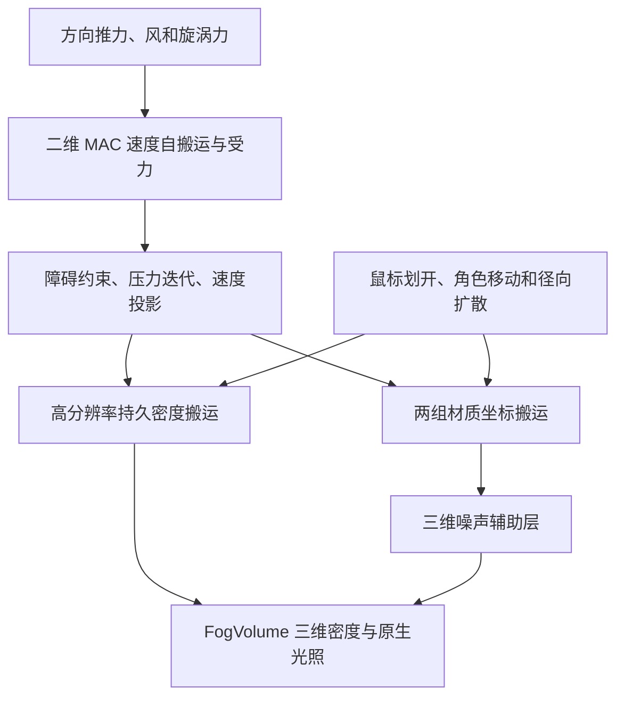

# Interactive Fog / 可交互贴地雾

Godot 4.7 / Forward+ 的浅层交互雾。二维流体负责水平运动，主要可见细节存在持久密度中；三维噪声补充纵向层次，并通过随流搬运的材质坐标采样。

交互让密度与纹理一起被推移、拉长和卷起，停止输入后继续演化。场内不再自动恢复固定图案，也不直接擦出空洞或填入预设浓雾环。

## 运行

打开 `project.godot`，等待 Compute Shader 导入，F5 运行。使用 Forward+，默认 Windows / D3D12；Mobile 和 Compatibility 不支持此处的 FogVolume。

在编辑器打开 `demo/terrain.tscn` 后按 F6，可单独运行缓坡、丘陵和浅沟演示。平地与起伏地形都可切换 FogVolume 高画质、FogVolume 性能、2.5D 薄层和切片四档。

| 输入 | 行为 |
| --- | --- |
| WASD / 方向键、Shift | 角色移动、加速，沿走过的路径向两侧拨雾 |
| 左键拖动 | 搅动：推动和卷动；划开：沿路径把雾拨向两侧 |
| 左键单击 | 搅动会注入小旋涡，划开会拨出局部缺口，爆开会从光标处径向推雾 |
| M / 面板工具按钮 | 在“搅动”“划开”“爆开”之间切换，默认搅动 |
| Space | 跳跃，起跳时脚下轻微聚雾，落地时从接触点向外散雾 |
| 右键拖动、滚轮 | 环绕相机、缩放 |
| R / P / Tab | 重置 / 暂停 / 二维场图 |

左侧可调光学密度、**上风边界补雾半衰期**、风速与层高。补雾只在入流边缘发生；场内稀疏区由周围流动填充，不按固定图案重新生成。

### 让雾贴合起伏地形

在 `FogField.height_map` 指定 `FogHeightMap`。给 `source` 选一张至少 2 × 2 的静态高度纹理，建议使用无损灰度图。 `world_bounds` 指定纹理首尾像素中心对应的世界 XZ 范围，图像行向世界 +Z 增长。 `height_range` 把红色通道的 0 和 1 映射到世界 Y 高度，单位为米。高度图需覆盖整个雾场，也可以由多个雾场共享。留空时使用雾场节点的 Y 作为平地高度。

演示的地面网格、碰撞和雾共享同一份高度数据，每个网格四边形沿左上至右下切成两个三角形。接入已有地形时，让雾和地面使用一致的坐标、采样点和三角划分。模拟仍在二维 XZ 网格上进行。

地形演示启用了顺坡搬运。可在 `FogField → Settings → 顺坡搬运` 调节 `Downslope Strength` 和 `Max Downslope Speed`。前者把每单位坡度换算为速度，后者限制网格面上的顺坡速度。新建设置默认强度为 0。

顺坡通量在普通流动和交互搬运后更新，密度与材质细节一起向低处移动。下游密度高过上游时，顺坡通量逐渐减弱，接近密度上限时只限制流入量。顺坡分量在固体和雾场边界处封闭，背景风仍按原有开放边界输运。

## 结构



速度采用交错 MAC 存储，压力与散度使用配对的前后差分。固体边界禁止穿入，区域边界开放。压力以上一步为初值。演示主场景使用多重网格，每步 2 个 V 循环；新建的 FogSettings 默认使用 64 轮 Jacobi。可在 FogField 的 Settings → 流体求解 → Pressure Solver 切换求解器，通过 Multigrid Cycles 调整每步 V 循环数。切换求解器保留压力、速度和雾的搬运历史。

密度使用 RK2 回溯、双三次重建及带局部极值限制的 MacCormack 校正，减少细丝反复搬运后的扩散。初始化图案包含大尺度疏密和窄密度脊；之后细节作为真实状态随速度搬运。仍存在采样与数值耗散，不能保证无限细的结构长期保持。

三维纹理不再以背景风乘时间自行漂移，也不再用瞬时速度偏移伪装搬运。两组二维材质坐标使用相同的速度和回溯路径，驱动三维噪声。它们错开周期刷新，并在刷新时将对应噪声权重降至零，以限制长期拉伸；**主密度不参与刷新**。这层噪声只补充厚度与次要纹理，不承担主要交互历史。

涡量约束用于补偿速度搬运损失。它不能制造速度网格无法分辨的微涡。默认 24 × 20 m 区域中，速度格约 9.4 × 7.8 cm，密度格约 4.7 × 3.9 cm；实际可分辨的涡旋需要跨越多个速度格。

方法参考：[GPU Gems 38：GPU 流体](https://developer.nvidia.com/gpugems/gpugems/part-vi-beyond-triangles/chapter-38-fast-fluid-dynamics-simulation-gpu)、[GPU Gems 3 / 30：高阶搬运](https://developer.nvidia.com/gpugems/gpugems3/part-v-physics-simulation/chapter-30-real-time-simulation-and-rendering-3d-fluids)。

### 多重网格压力原型

最细层使用与 Jacobi 相同的离散压力方程。每个 V 循环先做 2 次加权 Jacobi 平滑，把细网格残差限制到逐级减半的粗网格，在边长至多 8 的最粗层做 16 次平滑。向上逐级加回连通面插值的误差修正（阻尼 0.65），每层再平滑 4 次。2×2 子块中不连通的流体不合并，固体面封闭，域外修正压力为零。粗层随首次使用分配，障碍或模拟域变化时重建系数。

RTX 3050 Ti Laptop、Godot 4.7.2、D3D12、256² 速度 / 512² 密度，固定步长 1/30 s。每种配置独立运行三轮，每种交互预热 15 步、采样 90 步。下表为三轮完整模拟 GPU 单步中位数的中位数，单位 ms；测量区间包含速度、压力、密度与交互搬运，首次分配和拓扑重建在预热期完成。

| 交互 | Jacobi 64 | 2 个 V 循环 | 3 个 V 循环 |
|---|---:|---:|---:|
| 普通流动 | 0.915 | 0.794 | 1.060 |
| 持续划开 | 0.966 | 0.830 | 1.026 |
| 四处径向冲击 | 1.409 | 1.285 | 1.464 |

精度测试在圆柱和带 0.6 m 开口的薄墙周围施力。冷启动使用零初始压力，热启动从相同的 60 步 Jacobi 历史分叉。按 GPU 实际细网格系数计算相对残差 `‖b − Lp‖₂ / ‖b‖₂`，用同一矩阵的双精度稀疏直接解作速度参考。参考速度使用与 GPU 相同的压力梯度、固体面规则和速度限幅。

| 256² 同输入单步 | Jacobi 64 | 2 个 V 循环 | 3 个 V 循环 |
|---|---:|---:|---:|
| 冷启动相对压力残差 | 0.2610 | 0.2292 | 0.1640 |
| 热启动相对压力残差 | 0.2931 | 0.2281 | 0.1442 |
| 热启动距障碍 0.5 m 内的 MAC 速度 RMSE，m/s | 0.0875 | 0.0721 | 0.0505 |
| 热启动窄缝通量，m²/s（参考 0.967） | 0.888 | 0.901 | 0.908 |

各算法独立演化至第 91 步时，障碍附近对各自单步参考解的速度 RMSE 分别为 0.0340、0.0094、0.0039 m/s；移墙后第 10 步分别为 0.0533、0.0191、0.0101 m/s。三种算法所有封闭 MAC 面上的最大法向速度均为零，整墙隔离试验的无外力一侧保持零压力、零速度。在 65² 的奇数网格上，共同热启动的残差分别为 0.0400、0.0686、0.0271，小网格的精度排序随循环数变化。

两个 V 循环通过 D3D12 和 Vulkan 各 16 项传输回归。在 D3D12 的 32²、256²、512² 和 Vulkan 的 256² 网格上，各运行 900 步并移动两次障碍，10 个检查点的压力全部有限。Vulkan 的同输入热启动残差为 Jacobi 0.2930、两个 V 循环 0.2281。Vulkan 进程退出时两种配置均打印了 `OpVectorExtractDynamic is not supported yet`，本次验证未定位该消息来源。

[障碍速度场对照](artifacts/pressure-solver/obstacle-flow.png) · [逐轮 GPU 计时](artifacts/pressure-solver/timings.json) · [全部残差与速度指标](artifacts/pressure-solver/accuracy.json) · [跨后端与长时验证](artifacts/pressure-solver/validation.json)

复测计时运行 `godot --path . --script res://tests/flow_compute_budget.gd -- --multigrid --cycles=2`，省略用户参数即可测 Jacobi。精度采集使用 `tests/pressure_comparison.gd`，在 `--size=256` 与 `--size=65` 上分别运行 Jacobi（无求解器参数）、`--multigrid` 和 `--multigrid --cycles=3`。随后运行 `python tests/pressure_comparison.py`（NumPy、SciPy、Pillow）生成指标和图像。加上 `--soak` 可单独检查 900 步中两次移墙后的压力稳定性。

### 径向扩散

扩散是投影后的一条短时搬运路径。波前半径按平滑曲线增长，内部径向速度逐渐稀释中心，速度在外圈下降形成压缩。密度通过单元面上的有限体积通量重新分配，不直接清除圆盘或往预设圆环加雾。三维噪声坐标使用同一冲击速度回溯，所以细节会一同移动。

冲击速度预先构建为高分辨率 MAC 场；障碍距离场用于从源点进行保守的球面步进遮挡检查，固体面通量为零，近障碍速度沿表面导流。它不求解绕障碍传播的声波或完整三维爆炸。

冲击密度使用 MC 限制斜率重建与通量差更新，子步按 CFL 0.4 自动细分。内部密度和预测纹理为单通道 R32F，避免多子步反复量化；对渲染与场图的展示接口仍为 RGBA16F。正常流动仍走原有的高阶 MacCormack 搬运。冲击还向常规流场注入少量旋流，使波前在冲击结束后继续变形。

最多同时处理 4 个径向冲击。带采样边缘的作用矩形相交时合并，每组每主时间步最多 64 个 CFL 子步。分散的冲击独立计算速度上限。极小区域、高分辨率或极端重叠触及子步上限时，会按 CFL 约束削弱冲击速度。密度安全上限默认为 16，达到上限时会损失部分雾量；常规参数下的单次均匀雾扩散验收，二维密度积分误差约 0.003%。原理参考：[Clawpack 的有限体积与通量方法](https://www.clawpack.org/v5.3.x/wp_algorithms.html)。

### 沿路径划开

划开使用覆盖完整拖动线段的短时速度场，把雾拨向路径两侧。它与径向扩散共用有限体积搬运，密度和三维纹理坐标一起移动，不删除雾量。作用结束后保留疏密历史，由原有风和流动继续搬运、自然补位。切换工具、进入面板或松开左键会结束当前笔划，不跨越下一次输入连接路径。

默认半径 0.65 m、峰值速度 3 m/s、作用时间 0.3 s，主场景根节点可调整。最多保留 16 段轨迹，重叠路径取局部最强作用，避免移动缓慢时累加出过大速度。冲击速度与密度搬运都只派发到组内矩形。偶数子步直接写回当前状态，奇数子步只回拷本组矩形。

面板的 **Fog quality** 有四档。High（默认 288 / 192）和 Performance（224 / 128）使用 Godot 的体积雾网格。**Fog: 2.5D thin layer** 使用相机上的薄层合成效果。**Fog: horizontal slices** 用透明切片逐层绘制。两种自定义渲染器都会关闭演示环境的原生体积雾。四档共享实时流体纹理，暂停时也可切换并比较同一片雾。

起伏地形的薄层合成读取地形块内的最低、最高高度，只在射线可能碰到雾层的区间取样，沿途累积消光。场景深度截断视线，四段光照也考虑地形遮挡。切片网格随地形起伏，根据视线与局部坡面夹角计算透明度，并按地形块近似排序。贴着地面的视角仍可能看见切片间隔或局部透明混合误差。高度图很密时，切片网格会适当降低细分。

### 水平切片原型

在主场景的 `FogField/HorizontalSlices` 可调整 `Slice Count`（1–12，默认 6）。一个 MultiMesh 绘制沿高度排列的平面，靠近地面的层更密。每层与 FogVolume 共用同一消光函数，根据层厚和视线角度计算透明度，接受场景灯光和阴影贴图。这个方法按全分辨率叠画透明像素，低角度或绕着柱脚看时，可以看见相邻平面之间的间隔。切片使用场景灯光的表面照明强度，原生体积雾专用的每灯能量倍率仅在 FogVolume 中由引擎自动应用。

四档重新运行同一段 6 秒重放，条件为 Godot 4.7.2、D3D12 Forward+、RTX 3050 Ti Laptop、1080p 离屏视口、关闭垂直同步。每档四轮，每轮记录 312 帧，每档在轮次中的出场位置各用一次。表中为各轮统计量的中位数，单位 ms。旧版三档实验的独立数据列在下一节。

| 渲染档 | 整帧中位 | 整帧 P95 | 整帧 P99 | 视口 GPU 中位 |
|---|---:|---:|---:|---:|
| FogVolume 高画质 | 10.54 | 24.91 | 25.79 | 9.18 |
| FogVolume 性能档 | 5.87 | 19.20 | 20.72 | 4.45 |
| 2.5D 薄层 | 4.17 | 11.56 | 17.45 | 1.73 |
| 六层水平切片 | 4.93 | 18.20 | 20.33 | 3.46 |

另做两轮三层和六层的交换次序测试。三层 / 六层的视口 GPU 中位耗时为 2.18 / 3.49 ms，整帧中位为 4.26 / 5.36 ms。三层的波前出现更宽的间隙。以上开销均包含场景，整帧 P95 是绘制完成信号之间的墙钟间隔。截图在单独进程中录制。

[四档同步视频](artifacts/horizontal-slices/replay.mp4) · [四档同帧截图](artifacts/horizontal-slices/comparison.jpg) · [三层与六层的波前局部](artifacts/horizontal-slices/slice-count.jpg) · [原始数据](artifacts/horizontal-slices/)

复测可运行 `godot --path . --audio-driver Dummy --rendering-driver d3d12 --script res://tests/thin_fog_replay.gd -- --mode=slices --layers=6 --run=1`。换用 `--layers=3` 即可测试三层，以 `--capture` 或 `--clip` 单独生成画面。测试其余三档时加 `--slice-comparison` 可将报告写入本轮目录。

### 2.5D 薄层原型对照

薄层在半宽、半高分辨率下求视线与雾层的交段，按不透明物体深度截断，再沿交段采样密度、高度和随流噪声。每条视线最多分四段计算光照，各段在消光加权的中心打光，并按前段的透射率累加散射。平地上，穿雾距离在 4 m 以内时仍取 4–16 次样本，超过 4 m 时逐步增加到最多 48 次，并错开相邻像素的采样位置以减轻侧视条纹。起伏地形沿用按地形块裁剪和采样的方式。最后按全分辨率深度放大并合成。

灯光读取演示的方向光、暖色聚光灯与冷色全向灯。柱子和墙以网格的实际尺寸和世界变换参与遮挡，直射光随阴影深度和掠过轮廓的距离柔和衰减。自定义模型可用雾障碍的形状和高度作为近似。无天空资源时，雾的环境色按环境的天空贡献比例混合，与原生体积雾使用同一颜色份额。角色会按深度遮住身后的雾。当前实现用于演示的单相机、单雾场。下列原型对照数据使用早期的单点打光版本。

RTX 3050 Ti Laptop、Godot 4.7.2、D3D12 Forward+、1920 × 1080 离屏视口，关闭垂直同步并隐藏 HUD。重放 360 帧，包含角色移动、划开、径向冲击、环绕和俯仰。每两帧推进一次 1/30 秒模拟；先预热 60 帧，再从重放第 48 帧开始记录 312 个整帧墙钟间隔和视口 GPU 查询值。每档独立启动三次，按高 / 性能 / 薄层、性能 / 薄层 / 高、薄层 / 高 / 性能轮换。下表取三次各项统计量的中位数，单位 ms。录像、截图和纹理读回均在计时区间之外。

| 渲染档 | 整帧中位 | 整帧 P95 | 整帧 P99 | 视口 GPU 中位 | 视口 GPU P95 |
|---|---:|---:|---:|---:|---:|
| FogVolume 高画质 | 10.20 | 11.97 | 12.35 | 9.07 | 10.65 |
| FogVolume 性能档 | 5.75 | 8.64 | 10.46 | 4.43 | 5.70 |
| 2.5D 薄层 | 3.83 | 8.10 | 9.26 | 1.73 | 2.06 |

薄层在低角度保留了更锐利的波前与尾流，冷灯照亮的雾更亮，近景可看到沿波前的条纹。第 96、164、268 帧的密度展示纹理及材质坐标合并 SHA-256 在三档间逐帧相同。整帧 P95 的三轮范围为高画质 11.70–12.00 ms、性能档 7.80–8.94 ms、薄层 6.96–8.50 ms。

[三档同帧画面](artifacts/thin-fog/comparison.jpg) · [同步重放视频](artifacts/thin-fog/replay.mp4) · [原始计时 JSON 与 1080p 截图](artifacts/thin-fog/)

重测可运行以下命令，把 `thin` 换为 `high` 或 `performance`，用 `--run=2` 等编号区分轮次。将 `--run=1` 换为 `--capture` 可生成三张原图；`--clip` 会额外输出 20 fps 的视频帧至 `.godot/thin-clips/`。

```sh
godot --path . --audio-driver Dummy --rendering-driver d3d12 --script res://tests/thin_fog_replay.gd -- --mode=thin --run=1
```

## 参数与编辑器

在 `demo/main.tscn` 选中 **FogField → Settings**。开启编辑器的“使用场景环境 / 使用场景灯光”可预览。所有外观参数即时同步；流动参数在下一步生效。

| 参数 | 默认值 | 含义 |
| --- | --- | --- |
| Area Size | 24 × 20 m | 世界 XZ 覆盖范围，原点为雾层底部中心 |
| Resolution | 256² | 速度、压力、诊断纹理尺寸 |
| 密度与材质坐标 | Resolution 的两倍边长，默认 512² | 跟随速度分辨率一起重建 |
| Simulation Hz | 30 Hz | 固定模拟频率 |
| Pressure Iterations | 64 | 压力精度与 GPU 成本 |
| Wind Velocity | (0.7, 0.18) m/s | 背景风 |
| Wind Response / Velocity Damping | 0.12 / 0.08 | 回到背景风的响应与速度衰减 |
| Turbulence Strength / Scale | 0.25 / 1.2 | 进入求解器的旋流加速度与频率 |
| Vorticity Strength | 1.5 | 已分辨涡旋的耗散补偿 |
| Inflow Half Life | 1.5 s | 上风边缘的密度供给时间 |
| Density Variation / Pattern Scale | 1 / 0.55 | 初始化与新入流的密度结构；修改后按“重置雾场”重建初始状态 |
| Thickness / Density | 0.85 m / 2.6 | 最大高度与光学密度 |
| Detail Amount / Scale | 0.35 / 1.4 | 辅助三维纹理强度与空间频率 |
| Detail Reset Period | 12 s | 辅助坐标刷新周期，不清除主密度历史 |
| Detail Sharpness / Warp | 0.75 / 0.65 | 密度外观对比与随流坐标上的噪声域扭曲 |
| Max Compressed Density | 16 | 冲击路径的密度安全上限 |

`Preview In Editor` 控制编辑器播放，`Simulation Enabled` 控制流动。暂停会冻结密度、材质坐标及噪声动画；移动障碍仍更新遮罩与固体区域。修改分辨率、区域或场位置会重置状态；普通外观调整保留历史。

柱子与墙保留可编辑的二维足迹、可见几何同步及 Gizmo。自定义模型关闭 `Sync Prefab Geometry` 后独立配置足迹。原生 Light3D 的颜色、体积雾能量和阴影继续影响雾。

主场景保留已有的 0.85 m 层高、白色散射颜色与相机参数。旧的逐格恢复、清除强度和规则圆环挤压参数已移除；旧预设需要按新参数重新保存。

主场景根节点的“空格径向扩散”提供范围、强度倍率、持续时间、残留旋流和波前宽度。默认 3 m / 0.65 s / 强度 1 / 宽度 0.45 m。过短持续时间会按 8 m/s 的峰值冲击速度自动延长。浓雾波前可在原有 FogVolume 范围内增高，不改变普通雾层的高度。

## 复用与接口

实例化 `fog/scenes/fog_field.tscn`，在目标 Environment 开启体积雾并设全局体积密度为 0。雾场与父级保持零旋转、单位缩放，用 Area Size 调整范围。

移动物体下挂 `FogInteractor3D`，设置半径、方向推力和随移动增强的切向力。多个雾场独立记录物体上一位置。障碍使用 `FogObstacle3D`，足迹为二维，不能自动投影复杂多层地形。

```gdscript
# 注入一次速度冲量：位置、半径、XZ 速度增量、旋转速度增量。
$FogField.disturb(Vector3(0, 0, 2), 1.2, Vector2(2, 0), 1.5)

# 径向扩散：位置、范围、持续时间、强度倍率、残留旋流、波前宽度。
$FogField.burst(Vector3(0, 0, 2), 3.0, 0.65, 1.0, 1.5, 0.45)

# 线段拨开：起点、终点、作用半径、峰值速度、持续时间。
$FogField.part(Vector3(-2, 0, 1), Vector3(2, 0, 1), 0.65, 3.0, 0.3)
```

`get_state_texture()` 返回固定展示纹理：R 密度、GB 单元中心速度、A 保留。冲击期间 GB 包含常规流动与冲击速度，场图直接采样它显示密度与速度箭头，无运行时 GPU 回读。`get_coordinate_texture()` 返回两组持久坐标；`get_diagnostics_texture()` 的 R/G/B 分别为常规速度的投影后散度、涡量、投影前散度，不包含有意保留散度的冲击分量。

## 文件

- `fog/fog_simulation_gpu.gd`：GPU 资源与计算阶段的唯一拥有者。
- `fog/fog_field.gd`：场景接口、固定步、参数和交互收集。
- `fog/shaders/fluid_common.glslinc`：共享布局、MAC 采样、回溯与密度重建。
- `velocity / divergence / pressure_topology / pressure / project_velocity.glsl`：速度与压力求解。
- `density_predict / simulate.glsl`：密度预测校正与材质坐标搬运。
- `shock_field / shock_seed / shock_transport.glsl`：扩散与划开速度场、奇数子步的局部回拷、有限体积搬运。
- `build_obstacles.glsl`：几何变化时重建距离与法线。
- `ground_fog.gdshader`：从共享状态重建三维外观。
- `demo/`：角色、相机、灯光、笔刷和场图。
- `tests/`：实际 GPU 轨迹、渲染、编辑器与预算检查。

场景节点由 .tscn 声明；运行时只创建必要的材质、网格副本和 GPU 资源。瞬态材质通过 RenderingServer 绑定，不将 Texture2DRD 保存回场景。

## 验证

图形检查需要真实 GPU，不能加 `--headless`。将 godot 换成本机控制台可执行文件：

```powershell
godot --headless --editor --path . --import --quit
godot --path . --fixed-fps 60 --script res://tests/flow_transport.gd
godot --path . --fixed-fps 60 --script res://tests/flow_expansion.gd
godot --path . --fixed-fps 60 --script res://tests/flow_part.gd
godot --path . --script res://tests/gpu_smoke.gd
godot --path . --fixed-fps 60 --script res://tests/terrain_fog.gd
godot --path . --fixed-fps 60 --script res://tests/slope_transport.gd
godot --path . --fixed-fps 60 --script res://tests/field_map.gd
godot --path . --fixed-fps 60 --script res://tests/fog_detail.gd
godot --editor --path . -- --fog-editor-smoke

# 真实 1080p 离屏场景，预热 2 秒模拟时间、持续采样 5 秒墙钟时间。
godot --path . --script res://tests/flow_budget.gd
godot --path . --script res://tests/flow_budget.gd -- --close
godot --path . --script res://tests/flow_budget.gd -- --flow-only
godot --path . --script res://tests/flow_budget.gd -- --close --burst
godot --path . --script res://tests/flow_budget.gd -- --close --part
godot --path . --script res://tests/flow_budget.gd -- --close --four-bursts --trace
godot --path . --script res://tests/flow_budget.gd -- --close --performance --trace
godot --path . --script res://tests/flow_compute_budget.gd

# 固定步动态捕捉，105 帧 / 15 FPS / 7 秒。
godot --path . --fixed-fps 60 --script res://tests/flow_capture.gd
ffmpeg -framerate 15 -i artifacts/flow-transport/frames/%03d.png -c:v libx264 -crf 18 -pix_fmt yuv420p artifacts/flow-transport/interaction.mp4

# 爆开工具左键触发的扩散与随后尾流：120 帧 / 15 FPS / 8 秒。
godot --path . --fixed-fps 60 --script res://tests/expansion_capture.gd
ffmpeg -framerate 15 -i artifacts/expansion/frames/%03d.png -c:v libx264 -crf 18 -pix_fmt yuv420p artifacts/expansion/expansion.mp4

# M 切换后实际左键划开，再松手自然演化：120 帧 / 15 FPS / 8 秒。
godot --path . --fixed-fps 60 --script res://tests/part_capture.gd
ffmpeg -framerate 15 -i artifacts/part/frames/%03d.png -c:v libx264 -crf 18 -pix_fmt yuv420p artifacts/part/part.mp4
```

轨迹验收比较已知 1 m 风位移的密度与材质坐标，检查局部标记的位移、松手后的历史、密度范围、近似雾量保持、压力残差、暂停、障碍更新、重复坐标刷新和重置确定性。它不把“参数造成像素差”当成交互正确的证据。

扩散验收另行检查中心稀释、波前半径增长、浓度超过基准、总雾量误差、材质标记共同位移、空区二次冲击、30/60 Hz 一致性、暂停重置、隔墙遮挡、重叠上限、开放边界，以及爆开工具的左键输入与跳跃雾效。

划开验收检查快速线段的连续缺口、两侧堆积、密度积分、材质标记位移、松手历史、墙体遮挡和自然回填，以及交互器、暂停重置、模式按钮、M 键和左键接线。新增 19 项与已有 93 项检查均通过；均匀雾测试的密度积分误差约 0.0005%。预览位于 `artifacts/part/`。

`artifacts/flow-transport/` 保存密度前后图、动态预览、1080p 截图和预算 JSON。PNG 序列与日志不提交。`artifacts/fog-detail/` 保存静态远近景检查与改动前参考；新的外观判断应同时看动态预览。

本轮验证环境为 Windows / Godot 4.7.2 / D3D12 Forward+ / RTX 3050 Ti Laptop。预算报告记录整帧墙钟间隔和单视口 GPU 渲染时间；后者不单独代表流体计算耗时。关闭体积雾的对照保留流体与其余场景，用于粗略区分成本。

共享流场重构提交 `16e85bc` 的 288 / 192 体积采样下，1080p 近景两次连续复测的 P95 为 15.365 / 14.963 ms，最慢帧为 16.659 / 16.569 ms。每次先预热 2 秒模拟时间，再持续采样约 5 秒，笔刷沿固定轨迹持续推雾。对应报告为 `budget-full-close-repeat1.json`、`budget-full-close-repeat2.json`。该提交的轨迹、渲染、场图、GPU 集成及编辑器验收共 75 项检查通过；新增扩散结果见 `budget-full-close-burst.json` 及扩散验收输出。

径向扩散版本共通过 93 项检查，其中新增 18 项扩散回归。最终配置在相同机器上的 1080p 近景持续拖动、每 1.5 秒释放一次扩散，预热 2 秒后测量约 5 秒：整帧中位数 10.684 ms，P95 14.302 ms，最慢帧 15.154 ms。报告包含该场景和采样条件，不能据此保证所有窗口、设备或四重同时冲击都达到相同帧率。动态预览为 `artifacts/expansion/expansion.mp4`。

划开模式在同机 1080p 近景持续拖动、最多 8 段同时作用的预算测试中，中位数 10.627 ms、P95 12.368 ms、最慢帧 13.335 ms。条件为预热 2 秒模拟时间后采样约 5 秒；见 `budget-full-close-part.json`，不涵盖任意长线段或多交互器同时划开的最坏情况。

### 逐帧与单步计时

预算脚本的 `--trace` 会在采样结束后写入 `artifacts/flow-transport/frames-*.csv`。每一行保留观测帧号、墙钟间隔、process_frame / frame_pre_draw / frame_post_draw 三个信号之间的耗时、是否提交了固定步，以及引擎最近返回的渲染准备、视口 CPU / GPU 时间。GPU 查询有延迟，呈现等待也可能落在这些区间中。保持相同窗口条件比较长帧，各列不能简单相减作为 Present 耗时。

`flow_compute_budget.gd` 在真实渲染线程上给模拟提交前后各放一个 GPU 时间戳。常规流动、持续划开、四个分散冲击各预热 15 步、采样 90 步。这个探针关闭体积雾，GPU 时间戳差值沿用 [Godot 4.7.2 引擎的毫秒换算](https://github.com/godotengine/godot/blob/4.7.2-stable/servers/rendering/rendering_server_default.cpp#L142-L146)，单步时间与整帧预算分别报告。

### 优化前后对比

以提交 `3d833ba` 为基线，在同一台 RTX 3050 Ti Laptop 上使用 Godot 4.7.2 / D3D12。下表取两轮测量各自统计量的算术平均值，单位为毫秒。整帧测试使用固定 1080p 近景，单步测试保留 256² 速度、512² 密度与 64 次压力迭代。

| 场景 | 改前中位数 | 改后中位数 | 改前 P95 | 改后 P95 |
| --- | ---: | ---: | ---: | ---: |
| 常规流动，GPU 单步 | 1.362 | 0.930 | 1.735 | 1.066 |
| 连续划开，GPU 单步 | 1.461 | 0.961 | 1.819 | 1.136 |
| 四个分散冲击，GPU 单步 | 4.214 | 1.418 | 5.510 | 1.800 |
| High，整帧 | 10.45 | 10.12 | 25.12 | 24.90 |
| 224 / 128，整帧（基线手动设为相同网格） | 5.50 | 5.40 | 19.43 | 19.32 |

同画质下 GPU 单步变快，高画质整帧仍主要受体积渲染影响。单独对改后版本做详细追踪时，D3D12 High 最慢的 22 帧中仅 1 帧推进模拟，渲染前到渲染后信号之间的中位耗时为 24.34 ms。Windows 上可用 `godot --path . --rendering-driver vulkan` 试用 Vulkan Forward+。本机 Vulkan Performance 两次离屏近景的 P95 为 6.15 / 7.57 ms，P99 为 18.56 / 19.46 ms。真实窗口启用垂直同步时的结果另列在[完整对照数据](artifacts/flow-transport/optimization-comparison.json)。

## 成本与限制

默认 256² 速度 / 512² 密度的模拟纹理约 22.5 MiB，另有噪声、体积雾 froxel、阴影及引擎资源。所有计算留在主 RenderingDevice；CPU 只提交少量参数，无每帧 readback、submit 或 sync。最多 32 个障碍、单步 16 个常规作用、同时 4 个径向冲击及 16 段划开路径。

项目体积雾为 Volume Size 288 / Depth 192、关闭空间滤波，时间重投影为 0.75。连续复测时 320 的近景 P95 曾达到 17.3 ms，因此只小幅降低体积横向采样，保留速度和密度精度。这些选项明显影响细节、闪烁和拖影。近景细丝受最终 froxel 分辨率限制；加密二维场无法单独突破渲染采样上限。可优先切换 Performance 体积网格，再按需要分辨的涡旋尺度调整速度分辨率。

本模型是二维水平流动加三维外观，不求解上下穿插、真实三维翻卷或浅水自由表面。压力迭代、极值限制、开放边界和源项都可能引入守恒误差。快速移动障碍当前更新遮罩，连续推雾应同时配置交互器。极低帧率下每画面最多推进一步，会主动放慢模拟，避免作业堆积。

本轮包含这张显卡上的 D3D12 / Vulkan 和默认窗口检查。其他显卡、驱动及窗口呈现条件仍需单独测量。
